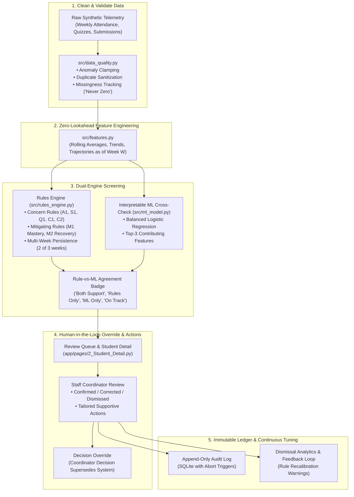

# SupportLens: Student Support Early-Warning Dashboard

[](tests/)
[](requirements.txt)
[](#ethical-guardrails-and-ground-rules)
[](LICENSE)

**SupportLens** is an interpretable, human-in-the-loop early-warning decision-support dashboard designed for university course coordinators. It proactively identifies students who may benefit from academic mentoring, study-skills workshops, or compassionate pastoral check-ins before minor setbacks compound into course withdrawal.

> **CRITICAL ETHICAL GUARANTEE:**  
> SupportLens is **supportive, never punitive**. It strictly forbids automated penalties, grading deductions, holds, or academic standing changes. Human review by an authorized academic coordinator is mandatory before any outreach.

---

## 🏛️ System Architecture



---

## 🚀 Quick Start

### 1. Set Up Virtual Environment & Install Dependencies

```bash
# Clone the repository
git clone https://github.com/example/SupportLens.git
cd SupportLens

# Create and activate virtual environment
python -m venv .venv

# Windows PowerShell:
.\.venv\Scripts\Activate.ps1

# Linux / macOS:
source .venv/bin/activate

# Install required dependencies
pip install -r requirements.txt
```

### 2. Generate Synthetic Dataset & Train Initial Models

```bash
# Generate synthetic dataset with default seed 42 (100 students, 12 weeks)
python -m src.data_generator --seed 42

# Train interpretable baseline ML models (Logistic Regression & Decision Tree)
python -m src.ml_model
```

### 3. Launch Interactive Streamlit Dashboard

```bash
streamlit run app/Home.py
```
*Open [http://localhost:8501](http://localhost:8501) in your browser.*

### 4. Run Test Suite

```bash
# Run complete test suite (49 automated unit and guardrail tests)
pytest -q
```

---

## 🧭 Page Guide

The dashboard is structured into 7 dedicated workflow pages accessible via the sidebar:

1. **`Home.py` (Cohort Pulse & Guided Demo):**  
   Longitudinal cohort pulse KPI tiles, interactive level distribution donut, multi-week attendance trendlines, data ingestion quality telemetry, and a **Guided Demo** panel with 1-click access to curated archetypes.
2. **`1_Cohort_Dashboard.py` (Cohort Overview & Support Triage):**  
   Filterable cohort roster table with Dual-Encoded badges, What-If threshold simulation panel, Cohort-Level Action Effectiveness metrics and bar chart (min-count rule $\ge 3$), and CSV / PDF / Markdown artifact downloads.
3. **`2_Student_Detail.py` (Student Profile & Action Panel):**  
   Deep-dive student view with 3 small-multiples trajectory charts (attendance, assignment strip, quiz pacing), plain-English "Why This Flag" rule explanations, "What's Going Well" strengths highlights, ML cross-check factors, and the coordinator Review & Action form.
4. **`3_Review_Queue.py` (Prioritised Triage Queue & Analytics):**  
   Urgency-sorted review queue, "Worth a Second Look" disagreement tab (cases where Rules and ML diverge), Action Tracker, and Dismissal Feedback Analytics (donut of outcomes, dismissal reasons bar, and rule review suggestions).
5. **`4_Evaluation.py` (Evaluation Integrity & Ablation):**  
   Multi-seed evaluation table (mean $\pm$ std across 5 seeds), box plots, baseline comparisons, earliness analysis histogram (Weeks to detection before drop), 6-configuration ablation study, archetype error analysis, and threshold sensitivity curves.
6. **`5_Fairness_and_Limits.py` (Subgroup Fairness & Missing-Data Stress Test):**  
   Post-hoc fairness audits across `cohort_group` (Sections A, B, C) and prior academic support history, live Demographic Parity and Equal Opportunity gap calculations, and missing-data stress test curves (5% to 30% added missingness).
7. **`6_Feature_Glossary.py` (Feature & Rule Dictionary):**  
   Transparent reference manual documenting every engineered feature, rule threshold, point weight, and ethical design principle.
8. **`7_Audit_Log.py` (Immutable Accountability Register):**  
   Append-only ledger displaying every automated screening, staff review decision, level override, and export event with actor codes and timestamps. Direct CSV download included.

---

## 🛡️ Ethical Guardrails and Ground Rules

SupportLens was engineered in strict adherence to foundational responsible AI principles:

| Principle | Technical Implementation |
|---|---|
| **100% Synthetic Data** | Only synthetic records are used; anonymized IDs (`S-0001`..`S-0100`). No real student identifiers, emails, or phone numbers. |
| **Supportive, Never Punitive** | Automated disciplinary actions, academic penalties, grading deductions, and enrollment holds are strictly prohibited and technically blocked. |
| **Protected Demographic Separation** | Group attributes (`cohort_group`, `prior_support_flag`) are strictly barred from ML feature engineering; used only in post-hoc fairness audits. |
| **"Missing is Never Zero"** | Missing records are never imputed as zero. The system averages over observed records only and abstains (`Insufficient Data`) when records are sparse. |
| **Multi-Week Persistence Filter** | Single-week drops are capped at `Monitor` ("Watching: single-week signal"); escalation requires concern in $\ge 2$ of the last 3 weekly snapshots. |
| **Mandatory Human-in-the-Loop** | Coordinator decisions always supersede automated system levels across all dashboards and reports. |
| **Append-Only Immutable Audit Log** | SQLite triggers `RAISE(ABORT)` on any `UPDATE` or `DELETE` attempt on `audit_log`. |
| **No Hard-Coded Metrics** | Every number, metric percentage, gap, and baseline in the UI and documentation is computed at runtime from code. |

---

## 📁 Repository Structure

```text
SupportLens/
├── app/
│   ├── Home.py                      # Dashboard entry point & Guided Demo panel
│   ├── components/
│   │   ├── badges.py                # Dual-encoded status & confidence badges
│   │   ├── charts.py                # Plotly visualizations & PIL trend graphics
│   │   └── guardrails.py            # Universal ethical banner & footer
│   ├── data_loader.py               # Cached data loading & snapshot preparation
│   └── pages/                       # 7 interactive Streamlit workflow pages
├── config.yaml                      # Configurable rule thresholds, weights & persistence
├── data/                            # Synthetic CSV datasets & trained model weights
├── db/
│   └── supportlens.db               # SQLite database with append-only audit triggers
├── docs/
│   ├── demo_script.md               # 5-minute live competition presentation flow
│   └── judge_qa.md                  # Comprehensive Judge Q&A reference
├── src/
│   ├── data_generator.py            # Latent archetype data synthesis & decline weeks
│   ├── data_quality.py              # Ingestion telemetry, clamping & deduplication
│   ├── evaluation.py                # Multi-seed stability, earliness, ablation, errors
│   ├── explain.py                   # Plain-English rule explanations & safety scanner
│   ├── export.py                    # Spec-compliant CSV, PDF report & audit logging
│   ├── fairness.py                  # Subgroup fairness audits & report generator CLI
│   ├── features.py                  # Zero-lookahead rolling behavioral feature engineering
│   ├── ml_model.py                  # Interpretable Logistic Regression & Decision Trees
│   ├── review_store.py              # Review state, action tracking & append-only audit
│   └── rules_engine.py              # Transparent rules engine with persistence & M1/M2
├── tests/                           # 49 unit, regression, export, and security tests
├── DATA_CARD.md                     # Dataset documentation, archetypes, and noise model
├── FAIRNESS_LIMITATIONS.md          # Live-generated fairness audit & limitations charter
├── requirements.txt                 # Pinned dependencies
└── README.md                        # Project documentation
```

---

## 📸 Guided Walkthrough & Key Archetypes

SupportLens includes a dedicated **Demo Mode** on the Home page allowing one-click inspection of 4 critical student archetypes:

1. **Gradual Decliner (`S-0084`):**  
   *What to notice:* Multi-week steady attendance and quiz drops trigger `Suggest Outreach`, confirmed by the 2-of-3 week persistence rule.
2. **Strong-but-Irregular (`S-0031`):**  
   *What to notice:* False-positive trap. Mitigating Rule M1 protects the student from an alert because quiz scores average $>85\%$ despite irregular attendance.
3. **Data-Gap Case (`S-0063`):**  
   *What to notice:* "Missing is never zero". Sparse attendance records cap data confidence and trigger an `Insufficient Data` records check rather than an alert.
4. **Recovering Student (`S-0023`):**  
   *What to notice:* Upward momentum in recent weeks avoids escalation, giving the student space to self-correct.

---

## 📜 Continuous Governance & Report Generation

To regenerate the standalone algorithmic fairness charter with live runtime numbers:
```bash
python -m src.fairness --write-report
```
*Outputs [FAIRNESS_LIMITATIONS.md](FAIRNESS_LIMITATIONS.md) reflecting exact runtime data and active pipeline metrics.*
